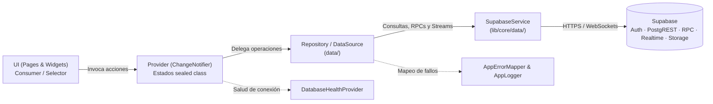
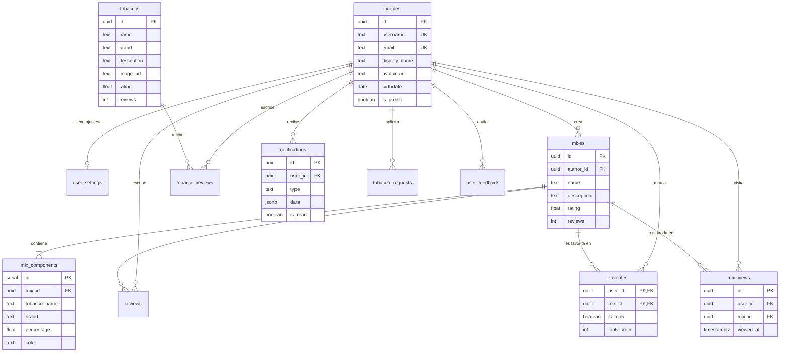

# Hookahub

> **Versión actual:** `1.1.0+2` · **Plataformas objetivo:** Android & iOS · **Stack:** Flutter (Dart `^3.9.2`) + Supabase

**Hookahub** es una aplicación móvil social para amantes de la cachimba (*shisha*) que permite descubrir tabacos de múltiples marcas, explorar recetas de la comunidad, crear mezclas con proporciones exactas al 100%, publicar reseñas verificadas, gestionar favoritos y un Top 5 personal, y recibir notificaciones en tiempo real.

---

## Tabla de Contenidos

- [1. Visión del Producto y Flujos Principales](#1-visión-del-producto-y-flujos-principales)
- [2. Stack Tecnológico Real](#2-stack-tecnológico-real)
- [3. Arquitectura y Estructura del Proyecto](#3-arquitectura-y-estructura-del-proyecto)
- [4. Matriz de Funcionalidades por Módulo (`lib/features/`)](#4-matriz-de-funcionalidades-por-módulo-libfeatures)
- [5. Modelo de Base de Datos, RPCs y Seguridad (Supabase)](#5-modelo-de-base-de-datos-rpcs-y-seguridad-supabase)
- [6. Instalación, Configuración y Comandos](#6-instalación-configuración-y-comandos)
- [7. Contexto para Auditoría, Jira AI y Generación de Backlog](#7-contexto-para-auditoría-jira-ai-y-generación-de-backlog)

---

## 1. Visión del Producto y Flujos Principales

Hookahub centraliza la experiencia completa de preparación y descubrimiento de mezclas de cachimba en cuatro pilares:

1. **Descubrimiento de Tabacos (`catalog`)**: Catálogo paginado con búsqueda, filtros por marca y valoración, vista detallada de cada sabor, reseñas de la comunidad y formulario para solicitar nuevos tabacos.
2. **Comunidad y Creación de Mezclas (`community` & `mixes`)**: Feed comunitario filtrable y ordenable, calculadora automática de proporciones al 100% (`MixPercentageCalculator`), edición transaccional de mezclas propias y reseñas con validación de calidad (`ReviewValidator`).
3. **Personalización y Seguimiento (`favorites`, `history`, `profile`)**: Guardado de mezclas favoritas, selección y reordenación de un **Top 5 personal**, historial reciente sin duplicados, gestión de perfil con avatar comprimido y soporte de tema claro/oscuro.
4. **Tiempo Real, Búsqueda Unificada y Retención (`search`, `notifications`, `auth`)**: Búsqueda global simultánea en tabacos y mezclas con caché L1 en memoria e historial local, centro de notificaciones por WebSockets (`Supabase Realtime`), enlaces profundos (`hookahub://` y HTTPS) y onboarding interactivo.

### Navegación Principal

La puerta de entrada (`AuthGate`) gestiona de forma reactiva tres estados:
- **Primer arranque**: secuencia de bienvenida (`OnboardingPage`), persistida localmente con `SharedPreferences`.
- **Usuario no autenticado o en flujo de recuperación de contraseña**: acceso a `LoginPage`, `RegisterPage`, `ForgotPasswordPage` y `ResetPasswordPage`.
- **Usuario autenticado**: shell principal `MainNavigationPage` con 4 pestañas con `Navigator` independiente por pestaña (`Inicio`, `Catálogo`, `Comunidad`, `Perfil`), buscador global integrado en la barra superior, acceso rápido al centro de notificaciones y banner global de conectividad (`DatabaseConnectionBanner`).

---

## 2. Stack Tecnológico Real

| Capa | Tecnología / Paquete | Propósito en Hookahub |
| :--- | :--- | :--- |
| **Framework UI** | Flutter (`Dart ^3.9.2`) · Material 3 | App móvil nativa para Android e iOS con temas duales (`AppTheme.lightTheme` / `AppTheme.darkTheme`) y paleta centralizada en `lib/core/constants.dart`. |
| **Estado** | `provider ^6.1.2` + `ChangeNotifier` | Inyección en árbol raíz vía `MultiProvider` (`lib/app.dart`) y estados UI modelados con **clases selladas (`sealed class`)** sin booleanos fragmentados. |
| **Backend & BaaS** | `supabase_flutter ^2.10.3` | PostgreSQL, GoTrue Auth, PostgREST, funciones RPC, Triggers SQL, Storage (`avatars` e imágenes de catálogo) y Supabase Realtime. |
| **Autenticación Social** | `google_sign_in ^7.2.0` | API Singleton v7 (`GoogleSignIn.instance`) con credenciales nativas Android (Debug/Release) e iOS enlazada a Supabase Auth. |
| **Configuración AOT** | `--dart-define-from-file=.env` (`Env`) | Inyección de variables en tiempo de compilación (`lib/core/config/env.dart`) sin empaquetar archivos `.env` en `assets/`. |
| **Conectividad y Salud** | `connectivity_plus ^7.3.1` + `DatabaseHealthService` | Detección de caída de red/BD con timeouts acotados (`4s` lectura, `8s` escritura) y banner no intrusivo con botón de reintento. |
| **Deep Linking y Compartir** | `app_links ^6.3.2`, `share_plus ^13.3.0`, `url_launcher ^6.3.1` | Navegación directa hacia tabacos/mezclas (`hookahub://share/...` y `https://hookahub.manutech.duckdns.org/share/...`) y callbacks OAuth (`io.supabase.flutter://login-callback/`). |
| **Imágenes y Medios** | `cached_network_image ^3.3.1`, `image_picker ^1.1.2`, `file_picker ^12.1.2`, `image_cropper ^12.2.1`, `flutter_image_compress ^2.3.0` | Selección, recorte, compresión (`512x512`, calidad `82`) y caché en RAM acotada en `UserAvatar` y `TobaccoImage`. |
| **Observabilidad y UX** | `logger ^2.7.0` (`AppLogger`), `toastification ^3.2.0` (`AppToast`), `timeago ^3.6.1` | Logging local solo en debug y envío remoto de `error`/`fatal` a la tabla `app_logs` (con timeout de `4s`), más mapeo de errores técnicos a español (`AppErrorMapper`). |
| **Monetización** | `google_mobile_ads ^9.1.0` | Banners adaptativos (`AdBannerWidget` / `AdBannerCard`) e intersticiales precargados (`InterstitialAdManager`) con IDs de prueba en debug y de producción vía `Env`. |
| **Persistencia Local e i18n** | `shared_preferences ^2.2.3`, `intl ^0.20.2`, `flutter_localizations` | Preferencias de tema, onboarding, historial de búsquedas recientes y base `l10n` (`lib/l10n/app_es.arb`, `app_en.arb`). |

---

## 3. Arquitectura y Estructura del Proyecto

Hookahub aplica **Clean Architecture modularizada por Feature**. Cada módulo en `lib/features/<feature>/` separa estrictamente:
- `data/`: repositorios y fuentes de datos locales o remotas (`SupabaseService`, `SharedPreferences`).
- `domain/`: entidades, modelos de dominio, filtros, interfaces de repositorio y reglas de negocio puras (por ejemplo, `MixPercentageCalculator`).
- `presentation/`: páginas, widgets específicos de la feature y `ChangeNotifier` providers con estados sellados.

### Flujo de Datos



### Estructura de Directorios

```text
hookahub/
├── .github/
│   ├── copilot-instructions.md      # Reglas de arquitectura y Documentación Viva para IAs
│   └── workflows/
│       └── antigravity-agent.yml    # Workflow de agente remoto en GitHub Actions
├── docs/
│   ├── configuracion_email_confirmacion.md
│   ├── supabase_endpoints.md
│   └── archive/                     # Histórico de notas técnicas de implementaciones pasadas
├── lib/
│   ├── main.dart                    # Inicialización: Env, Supabase, MobileAds, DeepLinkService
│   ├── app.dart                     # MultiProvider raíz, AppTheme, Toastification y l10n
│   ├── core/
│   │   ├── config/env.dart          # Variables compiladas vía --dart-define-from-file=.env
│   │   ├── constants.dart           # Paleta de colores, timeouts, rootNavigatorKey, appAvatarIcons
│   │   ├── storage.dart             # Persistencia de preferencias de tema
│   │   ├── theme.dart & theme_provider.dart
│   │   ├── data/supabase_service.dart
│   │   ├── models/                  # Modelos compartidos: mix.dart, tobacco.dart, review.dart, notification.dart
│   │   ├── providers/database_health_provider.dart
│   │   ├── services/                # database_health_service.dart, deep_link_service.dart, interstitial_ad_manager.dart
│   │   └── utils/                   # app_logger.dart, app_error_mapper.dart, app_toast.dart, review_validator.dart
│   ├── features/                    # 12 módulos funcionales (ver Sección 4)
│   ├── l10n/                        # Archivos ARB y localización generada (es, en)
│   └── widgets/                     # Widgets reutilizables (MainNavigationPage, MixCard, TobaccoCard, UserAvatar, TobaccoImage, AdBanner*, etc.)
├── scripts/
│   ├── tobacco_image_manager.py     # Pipeline Python para buscar, convertir a WebP y subir imágenes de tabacos
│   └── README.md
├── supabase/
│   ├── migrations/                  # Migraciones incrementales oficiales (RPCs, triggers, RLS, tablas)
│   └── sql/                         # Scripts SQL base de esquema y políticas de referencia
├── test/                            # 39 archivos de tests unitarios y de widgets (core, widgets y features)
├── .env.example                     # Plantilla de variables de entorno requeridas
├── GEMINI.md                        # Base de conocimiento técnico, bugs resueltos y reglas de oro
├── pubspec.yaml                     # Dependencias y configuración de assets/iconos/splash
└── README.md                        # Este documento
```

---

## 4. Matriz de Funcionalidades por Módulo (`lib/features/`)

| Módulo | Responsabilidad Funcional | Archivos Clave (`domain` / `data` / `presentation`) | Estado |
| :--- | :--- | :--- | :--- |
| **`auth`** | Inicio de sesión (Email/Password y Google Sign-In v7), registro con detección de `identities.isEmpty`, recuperación de contraseña vía Deep Link (`passwordRecovery`) y control de acceso en `AuthGate`. | `auth_provider.dart`, `auth_gate.dart`, `login_page.dart`, `register_page.dart`, `forgot_password_page.dart`, `reset_password_page.dart` | Implementado |
| **`home`** | Pantalla de inicio con estadísticas globales en tiempo real (`app_statistics`), accesos rápidos y mezclas destacadas. | `home_stats.dart`, `home_stats_repository.dart`, `home_stats_provider.dart`, `home_page.dart` | Implementado |
| **`catalog`** | Catálogo paginado de tabacos (`20` por página), filtros por marca (`get_available_tobacco_brands` RPC) y ordenación, detalle con reseñas CRUD (`TobaccoReviewsProvider`), mezclas relacionadas y solicitud de nuevos tabacos (`tobacco_requests`). | `catalog_filters.dart`, `tobacco_repository.dart`, `tobacco_reviews_repository.dart`, `catalog_provider.dart`, `tobacco_reviews_provider.dart`, `tobacco_lookup_provider.dart`, `tobacco_mixes_provider.dart`, `request_tobacco_provider.dart`, `catalog_page.dart`, `tobacco_detail_page.dart`, `request_tobacco_page.dart` | Implementado |
| **`community`** | Feed comunitario de mezclas con paginación y filtros por marca/tabaco/rating, creación y edición atómica de mezclas (`update_user_mix` RPC) con balanceo automático de porcentajes al 100%, detalle y reseñas con `ReviewValidator`. | `community_filters.dart`, `mix_percentage_calculator.dart`, `community_repository.dart`, `community_provider.dart`, `community_page.dart`, `create_mix_page.dart`, `mix_detail_page.dart` | Implementado |
| **`mixes`** | Listado y gestión de mezclas creadas por el usuario autenticado, con sincronización optimista del contador en `ProfileProvider`. | `user_mixes_repository.dart` (domain & data), `user_mixes_provider.dart`, `user_mixes_page.dart` | Implementado |
| **`favorites`** | Gestión de mezclas favoritas y selección/reordenación del **Top 5 personal** (`is_top5`, `top5_order`). | `favorites_repository.dart` (domain & data), `favorites_provider.dart`, `favorites_page.dart` | Implementado |
| **`history`** | Registro automático de mezclas visitadas mediante UPSERT único por `(user_id, mix_id)` y consulta filtrada por ventana reciente (por defecto últimos 2 días, límite 100). | `visit_entry.dart`, `history_repository.dart`, `history_provider.dart`, `history_page.dart` | Implementado |
| **`search`** | Búsqueda global unificada en tabacos y mezclas (`DefaultTabController` dinámico), sugerencias paralelas con caché L1 en memoria (LRU hasta 40 queries) e historial reciente persistido en `SharedPreferences`. | `search_suggestion.dart`, `search_history_local_data_source.dart`, `search_suggestions_repository.dart`, `search_provider.dart`, `search_suggestions_provider.dart`, `search_results_page.dart` | Implementado |
| **`notifications`** | Centro de notificaciones conectado por `Supabase Realtime` (reconciliación por lote), tipos extensibles (`NotificationType`), marcado como leído individual/masivo y navegación contextual (`NotificationActionHandler`). | `app_notification.dart`, `notification_payload.dart`, `notification_type.dart`, `notifications_repository.dart`, `notifications_provider.dart`, `notification_presentation_adapter.dart`, `notification_action_handler.dart`, `notifications_page.dart` | Implementado |
| **`profile`** | Visualización y edición de perfil (`username`, nombre, fecha de nacimiento), cambio de avatar (icono predefinido o foto comprimida con *cache-busting*), cambio de contraseña, ajustes y eliminación completa de cuenta (`delete_user_account` RPC). | `profile.dart`, `profile_repository.dart`, `profile_provider.dart`, `profile_page.dart`, `edit_profile_page.dart`, `change_password_page.dart`, `settings_page.dart` | Implementado |
| **`feedback`** | Envío de reportes de error, sugerencias y soporte (`FeedbackCategory`: `bug`, `suggestion`, `other`) con metadatos de plataforma y versión hacia `user_feedback`. | `feedback_category.dart`, `feedback_repository.dart`, `feedback_provider.dart`, `contact_page.dart` | Implementado |
| **`onboarding`** | Carrusel interactivo de 3 pasos en el primer arranque con persistencia local (`has_completed_onboarding_v1`). | `onboarding_item.dart`, `onboarding_provider.dart`, `onboarding_page.dart` | Implementado |

---

## 5. Modelo de Base de Datos, RPCs y Seguridad (Supabase)

Las definiciones SQL viven en `supabase/migrations/` (migraciones incrementales) y `supabase/sql/` (esquema inicial y políticas de referencia).

### Diagrama Entidad-Relación



Otras tablas de soporte y telemetría:
- `app_statistics` (fila única `id = 1` con `total_tobaccos`, `total_mixes`, `total_users`, actualizada automáticamente por triggers y expuesta vía Realtime).
- `tobacco_requests` (solicitudes de incorporación de nuevos tabacos con estados `pending`, `approved`, `rejected`).
- `user_feedback` (reportes y sugerencias con `category`, `platform`, `app_version`, `status`).
- `app_logs` (registro remoto de errores `error`/`fatal` emitidos por `AppLogger`).

### Funciones RPC y Triggers SQL

| Recurso PostgreSQL | Tipo | Propósito |
| :--- | :--- | :--- |
| `public.delete_user_account()` | RPC (`SECURITY DEFINER`) | Elimina `public.profiles` (aplicando `ON DELETE CASCADE` en datos privados y `ON DELETE SET NULL` en contenido comunitario) y borra el registro de `auth.users` cumpliendo políticas de App Store / Google Play. |
| `public.update_user_mix(p_mix_id, p_name, p_description, p_components)` | RPC (`SECURITY INVOKER`) | Actualiza la cabecera de la mezcla verificando autoría (`author_id = (select auth.uid())`) y reemplaza sus `mix_components` de forma atómica en una sola transacción. |
| `public.get_available_tobacco_brands()` | RPC (`STABLE`) | Devuelve `SELECT DISTINCT brand` desde PostgreSQL evitando descargar todo el catálogo ni sufrir el límite de 1.000 filas de PostgREST. |
| `update_mix_rating()` / `update_mix_rating_on_delete()` | Triggers (`SECURITY DEFINER`) | Recalculan `mixes.rating` y `mixes.reviews` automáticamente tras `INSERT`/`UPDATE`/`DELETE` en `reviews`, evitando bloqueos RLS cuando reseña un tercero. |
| `update_tobacco_rating()` / `update_tobacco_rating_on_delete()` | Triggers (`SECURITY DEFINER`) | Recalculan `tobaccos.rating` y `tobaccos.reviews` tras cambios en `tobacco_reviews`. |
| `update_statistics_tobaccos()` / `mixes()` / `users()` | Triggers (`SECURITY DEFINER`) | Mantienen sincronizada en vivo la tabla `app_statistics`. |

### Seguridad y Row Level Security (RLS)

- **Subconsultas en RLS (`initplan`)**: Todas las políticas nuevas utilizan `(select auth.uid())` en lugar de `auth.uid()` directo para evitar reevaluación por fila.
- **Storage (`avatars`)**: Bucket configurado como público (`public: true`) sin política `SELECT` genérica sobre `storage.objects` (bloquea scraping/listado de directorios) y mutaciones restringidas a la carpeta `<uid>/*`.
- **Tablas solo de escritura desde cliente (`tobacco_requests`, `user_feedback`, `app_logs`)**: Solo permiten `INSERT` al rol `authenticated` validando `(select auth.uid()) = user_id` (o esquema restringido para logs); la consulta administrativa se reserva al `service_role`.

---

## 6. Instalación, Configuración y Comandos

### Prerrequisitos

- **Flutter**: `3.47+` (Dart SDK `^3.9.2`)
- **Java / Android**: JDK 21 LTS (`flutter config --jdk-dir=...`), Gradle `8.14`, AGP `8.11.1`, Kotlin `2.2.20`
- **iOS**: Xcode + CocoaPods (en macOS)
- **Instancia de Supabase**: Proyecto configurado con las migraciones de `supabase/migrations/` y `supabase/sql/`

### Configuración del Entorno

1. Crea tu archivo `.env` a partir de la plantilla [`.env.example`](.env.example):
   ```bash
   cp .env.example .env
   ```
2. Rellena las claves requeridas en `.env` (el archivo `.env` está ignorado en Git y **nunca** debe declararse en `assets:` de `pubspec.yaml`):
   - `SUPABASE_URL` y `SUPABASE_ANON_KEY` (obligatorias para arrancar la app)
   - `GOOGLE_WEB_CLIENT_ID` y `GOOGLE_IOS_CLIENT_ID` (para Google Sign-In)
   - `ADMOB_BANNER_ANDROID_ID`, `ADMOB_BANNER_IOS_ID`, `ADMOB_INTERSTITIAL_ANDROID_ID`, `ADMOB_INTERSTITIAL_IOS_ID` (opcionales en debug; si están vacías en debug, se usan los IDs oficiales de prueba de Google)
   - `APPLE_APP_STORE_ID` (identificador de tienda iOS)

### Comandos Habituales

```bash
# Instalar dependencias
flutter pub get

# Ejecutar en desarrollo inyectando variables de entorno en compilación
flutter run --dart-define-from-file=.env

# Análisis estático (linting)
flutter analyze

# Ejecutar toda la suite de tests (39 ficheros en test/)
flutter test

# Compilar builds de producción
flutter build apk --dart-define-from-file=.env
flutter build appbundle --dart-define-from-file=.env
flutter build ipa --dart-define-from-file=.env
```

> **Nota sobre scripts auxiliares:** En [`scripts/`](scripts/README.md) existe la utilidad `tobacco_image_manager.py` (Python 3.8+) para automatizar la búsqueda, optimización WebP y carga masiva de imágenes de tabacos hacia Supabase Storage usando una `SUPABASE_SERVICE_KEY` independiente en `scripts/.env`.

---

## 7. Contexto para Auditoría, Jira AI y Generación de Backlog

> **Nota para herramientas de IA (Jira AI / Atlassian Rovo, Copilot, Cursor, revisores de código):**
> Antes de proponer incidencias, refactorizaciones o nuevas épicas, revisa las dos secciones siguientes para distinguir entre problemas **ya resueltos y blindados** (ver detalles técnicos en [`GEMINI.md`](GEMINI.md)) y **oportunidades reales de evolución**.

### A. Decisiones Arquitectónicas y Puntos Ya Blindados (No proponer como deuda pendiente)

| Área | Estado Blindado Actual | Referencia en Código |
| :--- | :--- | :--- |
| **Gestión de estados UI** | Los providers de carga/mutación utilizan `sealed class` (`Initial`, `Loading`, `Loaded`, `Error`) sin banderas booleanas fragmentadas. | `CatalogState`, `CommunityState`, `ProfileState`, `UserMixesState`, `NotificationsState`, `FavoritesState`, `HistoryState`, `HomeStatsState`, `SearchState`, `FeedbackState` |
| **Validación y unicidad de reseñas** | Validación unificada (`>= 5` palabras válidas de `>= 2` caracteres y `>= 15` caracteres útiles), prevención de duplicados por usuario, edición/borrado CRUD y fijado de la reseña propia en primer lugar. | `lib/core/utils/review_validator.dart`, `TobaccoReviewsProvider`, `MixDetailPage` |
| **Consumo de RAM en imágenes** | `UserAvatar` y `TobaccoImage` acotan el tamaño de decodificación (`LayoutBuilder`, tope `512px` físicos) pasando solo `memCacheWidth` para preservar relación de aspecto; subida de avatares comprimida (`512x512`, `q=82`) con *cache-busting* por timestamp. | `lib/widgets/user_avatar.dart`, `lib/widgets/tobacco_image.dart`, `ProfileRepository` |
| **Prevención de Overfetching / N+1** | Conteos vía `.count(CountOption.exact)` (`HEAD`), marcas únicas vía RPC `get_available_tobacco_brands()`, filtro de tabacos en Comunidad paginado a `50` con debounce de `300ms`, y resolución de componentes de mezcla en bloque (`.inFilter`). | `TobaccoRepository`, `CommunityRepository`, `UserMixesRepository` |
| **Atomicidad y Consistencia en BD** | Edición de mezclas transaccional en PostgreSQL (`update_user_mix`), triggers `SECURITY DEFINER` para `mixes.rating`/`reviews` y `tobaccos.rating`/`reviews`, y `ensureProfile` idempotente (`ignoreDuplicates`). | `supabase/migrations/`, `SupabaseService` |
| **Seguridad Auth, Backups y GDPR** | Detección de emails existentes con `identities.isEmpty`, aislamiento de `AuthChangeEvent.passwordRecovery`, `android:allowBackup="false"`, reglas ProGuard/R8, `Env` en compilación (sin `.env` en assets) y borrado integral `delete_user_account()`. | `AuthProvider`, `AndroidManifest.xml`, `Env`, `ProfileRepository` |
| **Resiliencia de Red y Realtime** | Timeouts explícitos (`4s` lectura, `8s` escritura, `4s` `app_logs`), reconciliación por lote en stream de `notifications` (sin `.expand()`), desconexiones transitorias de socket registradas como `warning` (sin saturar `app_logs`). | `lib/core/constants.dart`, `NotificationsProvider`, `DatabaseHealthService` |
| **Navegación y Rebuilds de UI** | Barra global sincronizada por `PageRoute` con `Expando<String>` y `_TabNavigatorObserver`, `ValueListenableBuilder` en búsqueda/formularios para evitar rebuilds del shell y contenedores de AdMob ocultos si no hay anuncio cargado. | `MainNavigationPage`, `AdBannerCard`, `AdBannerWidget` |

### B. Oportunidades de Evolución y Épicas Sugeridas (Backlog Abierto)

Las siguientes líneas representan áreas reales de mejora y nuevas funcionalidades donde la aplicación todavía tiene margen de crecimiento:

1. **Épica 1 — Internacionalización Completa (`i18n`)**:
   - *Situación actual*: `lib/l10n/app_es.arb` y `app_en.arb` contienen únicamente 3 claves (`appTitle`, `databaseOfflineMessage`, `databaseRetryButton`), mientras que la mayoría de pantallas, validadores (`ReviewValidator`, `AppErrorMapper`) y textos de UI están en español directo y `MaterialApp.locale` está fijado a `Locale('es', '')`.
   - *Mejora sugerida*: Extraer todos los textos visibles a archivos `.arb`, habilitar selector de idioma en `SettingsPage` y localizar `AppErrorMapper` y `ReviewValidator`.

2. **Épica 2 — Modo Offline y Caché Persistente de Lectura**:
   - *Situación actual*: Solo existen preferencias locales (`SharedPreferences`) para tema, onboarding e historial de búsquedas, más una caché L1 volátil en memoria para sugerencias de búsqueda. Sin conexión, `CatalogPage`, `FavoritesPage` y `UserMixesPage` no muestran datos cacheados en disco.
   - *Mejora sugerida*: Incorporar persistencia local estructurada (ej. caché JSON versionada o SQLite/Drift) para consultar favoritos, Top 5, mezclas propias y catálogo reciente sin conexión.

3. **Épica 3 — Cobertura de Tests de Integración (E2E) y Módulos Menos Cubiertos**:
   - *Situación actual*: Existen `39` archivos en `test/` centrados en providers, utilidades core y widgets clave (`TobaccoImage`, `UserAvatar`), pero no hay carpeta `integration_test/` ni tests específicos para `feedback`, `onboarding`, `EditProfilePage`, `SettingsPage` o `RequestTobaccoPage`.
   - *Mejora sugerida*: Añadir tests de widgets para formularios de perfil/feedback/solicitudes y configurar flujos `integration_test` críticos (Login → Catálogo → Crear Mezcla → Reseñar).

4. **Épica 4 — Expansión Social, Gamificación y Compartición Rica**:
   - *Situación actual*: `NotificationType` ya contempla eventos futuros como `followNewMix`, `reviewReply`, `achievement`, `weeklyDigest` o `mixTrending`, y `profiles` tiene el campo `is_public`, pero aún no existen pantallas públicas de otros autores, sistema de seguidores ni generación visual de tarjetas compartibles.
   - *Mejora sugerida*: Implementar perfil público visitable de otros creadores, seguimiento entre usuarios, logros/insignias de mezclador, y exportación de mezclas como tarjeta visual (`RepaintBoundary` + `share_plus`) junto con verificación de Universal Links / App Links en `hookahub.manutech.duckdns.org`.

5. **Épica 5 — CI/CD Automatizado en GitHub Actions**:
   - *Situación actual*: `.github/workflows/` contiene únicamente `antigravity-agent.yml`; no hay pipeline automático de validación en Pull Requests o pushes.
   - *Mejora sugerida*: Crear workflows de CI para ejecutar `flutter analyze` y `flutter test` automáticamente en cada PR, verificar formato (`dart format --output=none --set-exit-if-changed`) y automatizar builds/entregas a Firebase App Distribution, Google Play Internal Testing o TestFlight.

6. **Épica 6 — Flujo de Moderación y Administración**:
   - *Situación actual*: Las tablas `tobacco_requests` y `user_feedback` reciben registros desde la app con estados (`pending`, `approved`/`resolved`, etc.), y los usuarios pueden crear contenido abierto en `mixes`, `reviews` y `tobacco_reviews`, sin mecanismos in-app de reporte de abuso ni vista de estado para el solicitante.
   - *Mejora sugerida*: Añadir botón de reporte de contenido inapropiado en mezclas/reseñas, mostrar al usuario el historial/estado de sus solicitudes de tabacos y habilitar webhooks o notificaciones automáticas (`feedbackResponse`, `newTobacco`) cuando un administrador resuelva una solicitud.

---

> **Mantenimiento automático de este documento:** Por directiva del repositorio ([`.github/copilot-instructions.md`](.github/copilot-instructions.md) y [`GEMINI.md`](GEMINI.md)), cualquier agente de IA o desarrollador que implemente una nueva funcionalidad, migración SQL o mejora arquitectónica debe actualizar este `README.md` en el mismo cambio.
